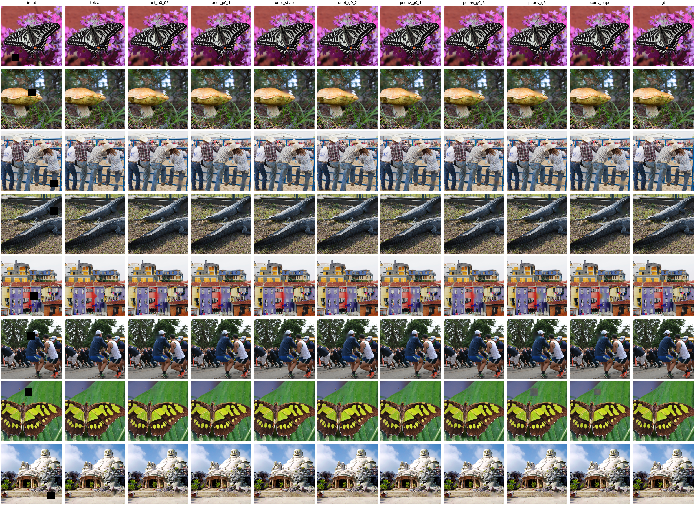
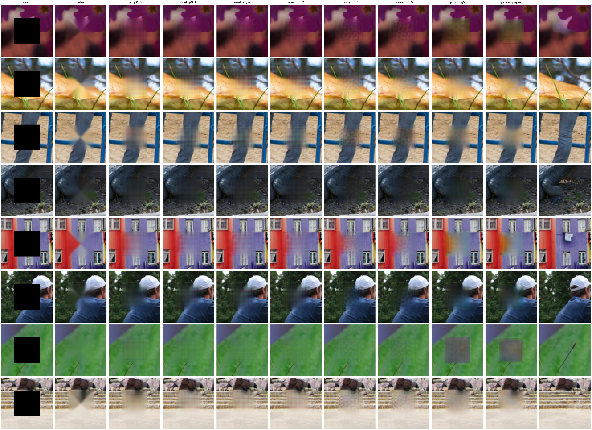
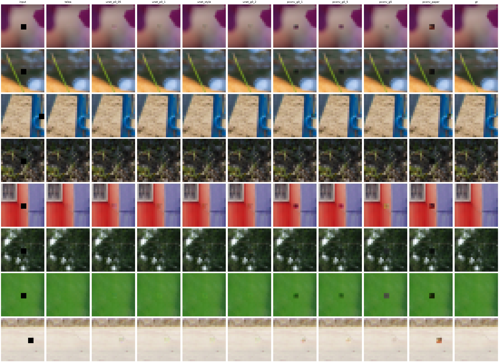

# Projekt 1

Grzegorz Statkiewicz, Mikołaj Różycki

## 4. Inpainting

Celem zadania jest wypełnienie dziur 3x3 i 32x32 w obrazach ze zbioru DIV2K w rozdzielczości 256x256.

### Dane

Wykorzystano zbiór DIV2K (wariant High Resolution). Z 800 obrazów treningowych wydzielono 760 obrazów treningowych oraz 40 walidacyjnych. Obrazy pomniejszane są losowo (najpierw downscale do 256 na krótszym boku, następnie losowy wycinek względem dłuższego boku) do rozdzielczości 256x256. Ponieważ zbiór jest bardzo mały, dla każdego obrazu stosujemy N losowych wycięć (w eksperymentach zastosowaliśmy 10). Dodatkowo w trakcie treningu obrazy są augmentowane (losowe odbicie i obrót).

### Metryki

PSNR, SSIM i LPIPS oblicza się na całym obrazie, a hole PSNR i hole MAE tylko na pikselach maski. W końcowej ewaluacji PSNR wynika z błędu kwadratowego zgromadzonego po wszystkich próbkach.

todo opisz krótko każdą z metryk co mierzy

### Podejście i modele

#### U-Net z połączeniami rezydualnymi

Jako punkt wyjścia wybrano sieć U-Net, dodatkowo dodano połączenia rezydualne w blokach konwolucyjnych. Model na wejściu przyjmuje obraz RGB po wycięciu maski oraz samą maskę. Zwraca trzy kanały RGB obrazu.

| Stage | Channels | Size | Operation |
|---|---|---|---|
| Input | 4 | 256×256 | Masked RGB + hole mask |
| Encoder 1 | 32 | 256×256 | Conv + SiLU, 2 residual blocks |
| Encoder 2 | 64 | 128×128 | Strided conv, 2 residual blocks |
| Encoder 3 | 128 | 64×64 | Strided conv, 2 residual blocks |
| Bottleneck | 256 | 32×32 | Strided conv, 2 residual blocks |
| Decoder 3 | 128 | 64×64 | Upsample, skip concat, reduction, 2 residual blocks |
| Decoder 2 | 64 | 128×128 | Upsample, skip concat, reduction, 2 residual blocks |
| Decoder 1 | 32 | 256×256 | Upsample, skip concat, reduction, 2 residual blocks |
| Output | 3 | 256×256 | Conv + Sigmoid |

#### Partial Convolution

Docelową architekturą do przrtestowania było [Partial Convolution](https://arxiv.org/abs/1804.07723) wraz z oryginalną funkcją straty. PartialConv mnoży cechy przez maskę poprawnych wartości, przeskalowuje odpowiedź zależnie od liczby dostępnych elementów okna i aktualizuje maskę. W miejscu bez poprawnych elementów zwraca zero. Wewnątrz maska jest odwracana, ponieważ PartialConv używa `1` dla poprawnych wartości. 

Wychodząc od modelu U-Net, zwykłe konwolucje zastąpiono PartialConv, a bloki rezydualne zastąpiono blokami z dwiema konwolucjami bez dodawania wejścia. Przy dwóch blokach na poziom liczba konwolucji pozostaje taka sama. Najpierw wykorzystano tego samego `InpaintingLoss` co dla modelu U-Net, stoponiowo przechodząc do oryginalnej funkcji straty z publikacji. Funkcja opisana przez autorów została zaimplementowana jako `PartConvLoss`.

Poniższa tabela przedstawia zaimplementowany `PartialUNet`. Każdy `PartialBlock` zawiera dwie konwolucje PartialConv 3×3 z aktywacją SiLU, bez połączenia rezydualnego.

| Stage | Channels | Size | Operation |
|---|---|---|---|
| Input | 4 | 256×256 | Masked RGB + hole mask (inverted) |
| Encoder 1 | 32 | 256×256 | PartialConv + SiLU, 2 PartialBlocks |
| Encoder 2 | 64 | 128×128 | Strided PartialConv, 2 PartialBlocks |
| Encoder 3 | 128 | 64×64 | Strided PartialConv, 2 PartialBlocks |
| Bottleneck | 256 | 32×32 | Strided PartialConv, 2 PartialBlocks |
| Decoder 3 | 128 | 64×64 | Upsample, skip concat (256+128), PartialConv + SiLU, 2 PartialBlocks |
| Decoder 2 | 64 | 128×128 | Upsample, skip concat (128+64), PartialConv + SiLU, 2 PartialBlocks |
| Decoder 1 | 32 | 256×256 | Upsample, skip concat (64+32), PartialConv + SiLU, 2 PartialBlocks |
| Output | 3 | 256×256 | PartialConv + Sigmoid |


### Funkcja straty

Punktem wyjścia jest Masked L1, czyli średni bezwzględny błąd kolorów w dziurze. W `InpaintingLoss` można do niego dodać:

- **Valid L1**: błąd na znanych pikselach  (uczy model zachowywać otoczenie)
- **Gradient**: porównanie zmian kolorów między sąsiednimi pikselami (pomaga odtwarzać krawędzie i ich ciągłość na granicy dziury)
- **Perceptual**: porównanie cech obrazów przez VGG-16
- **Style**: porównanie statystyk cech VGG-16 (pomaga dopasować teksturę wypełnienia do referencji)
- **TV**: kara za gwałtowne zmiany kolorów (wygładza wypełnienie i ogranicza artefakty)

Dla `InpaintingLoss` końcowa strata ma postać:

$$
\mathcal{L}_{Inpainting} =
\lambda_{hole}\mathcal{L}_{hole}
+ \lambda_{valid}\mathcal{L}_{valid}
+ \lambda_{gradient}\mathcal{L}_{gradient}
+ \lambda_{perceptual}\mathcal{L}_{perceptual}
+ \lambda_{style}\mathcal{L}_{style}
+ \lambda_{tv}\mathcal{L}_{tv}.
$$


`PartConvLoss` zawiera Hole L1, Valid L1, perceptual, style i TV, bez składnika gradientowego:

$$
\mathcal{L}_{PartConv} =
\lambda_{hole}\mathcal{L}_{hole}
+ \lambda_{valid}\mathcal{L}_{valid}
+ \lambda_{perceptual}\mathcal{L}_{perceptual}
+ \lambda_{style}\left(\mathcal{L}_{style_{out}} + \mathcal{L}_{style_{comp}}\right)
+ \lambda_{tv}\mathcal{L}_{tv}.
$$

Składniki $\mathcal{L}_{style_{out}}$ i $\mathcal{L}_{style_{comp}}$ dotyczą odpowiednio surowego wyjścia i obrazu z wklejoną rekonstrukcją.

### Eksperymenty

Wspólne hiperparametry treningów:

| Parameter | Value |
|---|---|
| Seed | 42 |
| Input size | 256×256 |
| Training hole size | 32×32 |
| Steps | 5000 |
| Optimizer | AdamW |
| Initial learning rate | 0.0002 |
| Adam betas | (0.9, 0.999) |
| Weight decay | 0.0001 |
| Scheduler | CosineAnnealingLR |
| Minimum learning rate | 0.00001 |
| Gradient clipping, max norm | 1.0 |

Poniższe tabele przedstawiają przeprowadzone eksperymenty oraz wyniki. Kolumny od `Hole L1` do `TV` podają wagi składników lossu użytych w eksperymentach, również wartości domyślne. `0` oznacza składnik wyłączony lub niewystępujący w danej funkcji straty. Puste pola dla Telea oznaczają brak treningowej funkcji straty.

Wagi odczytano z konfiguracji zapisanych przy treningach. `InpaintingLoss` normalizuje L1 osobno przez obszar dziury i tła, a `PartConvLoss` przez cały obraz, dlatego te same wartości wag nie oznaczają identycznego udziału składników.

#### Maska 32×32

Tabela obejmuje jeden seed masek na 100 obrazach testowych. Oceniany jest najlepszy checkpoint (wg. największego PSNR). Pogrubiono wyniki lepsze od baseline’u Telea, a najlepszy wynik każdej metryki dodatkowo podkreślono.

| Method | Model | Loss | Hole L1 | Valid L1 | Gradient | Perceptual | Style | TV | Image PSNR ↑ | Image SSIM ↑ | Image LPIPS ↓ | Hole PSNR ↑ | Hole MAE ↓ |
| --- | --- | --- | ---: | ---: | ---: | ---: | ---: | ---: | ---: | ---: | ---: | ---: | ---: |
| telea | OpenCV Telea |  |  |  |  |  |  |  | 34.50 | 0.9906 | 0.0133 | 16.44 | 0.0961 |
| unet_p0_05 | ResidualUNet | InpaintingLoss | 1 | 0.1 | 0.1 | 0.05 | 0 | 0 | **35.12** | 0.9905 | 0.0137 | **17.06** | **0.0933** |
| unet_p0_1 | ResidualUNet | InpaintingLoss | 1 | 0.1 | 0.1 | 0.1 | 0 | 0 | <u>**35.62**</u> | <u>**0.9910**</u> | **0.0107** | <u>**17.56**</u> | <u>**0.0854**</u> |
| unet_style | ResidualUNet | InpaintingLoss | 1 | 0.1 | 0.1 | 0.1 | 1 | 0 | **35.54** | **0.9910** | **0.0105** | **17.47** | **0.0860** |
| unet_g0_2 | ResidualUNet | InpaintingLoss | 1 | 0.1 | 0.2 | 0.1 | 0 | 0 | **35.57** | **0.9910** | **0.0110** | **17.51** | **0.0856** |
| pconv_g0_1 | PartialUNet | InpaintingLoss | 1 | 0.1 | 0.1 | 0.1 | 0 | 0 | **35.55** | **0.9909** | <u>**0.0100**</u> | **17.49** | **0.0861** |
| pconv_g0_5 | PartialUNet | InpaintingLoss | 1 | 0.1 | 0.5 | 0.1 | 0 | 0 | **35.59** | **0.9910** | **0.0103** | **17.53** | **0.0855** |
| pconv_g5 | PartialUNet | InpaintingLoss | 1 | 0.1 | 5 | 0.1 | 0 | 0 | **35.24** | **0.9907** | 0.0135 | **17.18** | **0.0921** |
| pconv_paper | PartialUNet | PartConvLoss | 64 | 0.1 | 0 | 0.01 | 1 | 0.1 | **35.12** | 0.9905 | 0.0136 | **17.06** | **0.0935** |

Dla maski 32×32 najlepszy wyniki uzyskał `unet_p0_1` (Image PSNR 35.62, Image SSIM 0.9910, Hole PSNR 17.56, Hole MAE 0.0854), natomiast najniższy LPIPS uzyskał `pconv_g0_1` (0.01).





Wizualnie Telea dobrze uzupełnia jednolite obszary, ale przy zmiennych kształtach i dużej częstotliwości rozciąga kolory i tworzy sztuczne połączenia krawędzi. Zwiększenie wagi perceptual z 0.05 do 0.1 poprawia ciągłość konturów, co widać m.in. na nogawce i ścianie. Dodanie style oraz zwiększenie gradientu pomagają miejscami odtworzyć fakturę i linie, jednak nie dają wyraźnej poprawy względem `unet_p0_1`. PartialConv z umiarkowaną wagą gradientu dodaje drobne szczegóły, które widać w tle jednak samo uzupełnienie wydaje się zamazane. Przy wadze gradientu 5 oraz w wariancie `pconv_paper` widoczne są odbarwienia oraz artefyakty które sugerują niedouczenie modelu.

Największą trudność stanowi dokładne odwzorowanie kształtu obiektów i przebiegu krawędzi wewnątrz wycięcia. Całościowo najlepiej poradził sobie wariant `unet_p0_1`, jednak we wszystkich wariantach rekonstrukcje większych dziur pozostają dość rozmazane.

#### Maska 3×3


| Method | Model | Loss | Hole L1 | Valid L1 | Gradient | Perceptual | Style | TV | Image PSNR ↑ | Image SSIM ↑ | Image LPIPS ↓ | Hole PSNR ↑ | Hole MAE ↓ |
| --- | --- | --- | ---: | ---: | ---: | ---: | ---: | ---: | ---: | ---: | ---: | ---: | ---: |
| telea | OpenCV Telea |  |  |  |  |  |  |  | 60.12 | <u>1.0000</u> | <u>0.0000</u> | 21.50 | <u>0.0542</u> |
| unet_p0_05 | ResidualUNet | InpaintingLoss | 1 | 0.1 | 0.1 | 0.05 | 0 | 0 | 59.54 | 0.9999 | 0.0001 | 20.92 | 0.0654 |
| unet_p0_1 | ResidualUNet | InpaintingLoss | 1 | 0.1 | 0.1 | 0.1 | 0 | 0 | **60.49** | 0.9999 | 0.0000 | **21.87** | 0.0572 |
| unet_style | ResidualUNet | InpaintingLoss | 1 | 0.1 | 0.1 | 0.1 | 1 | 0 | **60.39** | 0.9999 | 0.0000 | **21.77** | 0.0578 |
| unet_g0_2 | ResidualUNet | InpaintingLoss | 1 | 0.1 | 0.2 | 0.1 | 0 | 0 | <u>**60.63**</u> | 0.9999 | 0.0000 | <u>**22.00**</u> | 0.0560 |
| pconv_g0_1 | PartialUNet | InpaintingLoss | 1 | 0.1 | 0.1 | 0.1 | 0 | 0 | 55.38 | 0.9998 | 0.0005 | 16.76 | 0.1093 |
| pconv_g0_5 | PartialUNet | InpaintingLoss | 1 | 0.1 | 0.5 | 0.1 | 0 | 0 | 56.70 | 0.9998 | 0.0003 | 18.07 | 0.0921 |
| pconv_g5 | PartialUNet | InpaintingLoss | 1 | 0.1 | 5 | 0.1 | 0 | 0 | 59.02 | 0.9999 | 0.0001 | 20.40 | 0.0677 |
| pconv_paper | PartialUNet | PartConvLoss | 64 | 0.1 | 0 | 0.01 | 1 | 0.1 | 50.01 | 0.9996 | 0.0018 | 11.39 | 0.2237 |

Dla maski 3×3 najwyższy PSNR uzyskał `unet_g0_2` (60.63 dla obrazu i 22.00 w dziurze), ale Telea zachowała przewagę w MAE, SSIM i LPIPS. Dane 3x3 nie były uwzględniane bezpośrednio w treningu, jednak trening na wyższych maskach dość dobvrze generalizuje również te mniejsze. 



### Uruchomienie eksperymentu

Komendy wykonujemy z głównego katalogu repozytorium. Potrzebne są `uv`, `wget` i `unzip`. Dane DIV2K pobieramy skryptem, który rozpakowuje obrazy do `p1/data/raw/DIV2K/train` oraz `p1/data/raw/DIV2K/valid`:

```bash
bash p1/scripts/download_data.sh
```

Następnie instalujemy zależności i uruchamiamy trening, wskazując konfigurację odpowiadającą nazwie metody w tabeli:

```bash
uv sync
bash p1/scripts/inpainting/train.sh p1/configs/unet_p0_1.yaml
```

Aby uruchomić inny wariant, zmieniamy ścieżkę konfiguracji, np. na `p1/configs/pconv_paper.yaml`. Po treningu automatycznie wykonywana jest ewaluacja najlepszego checkpointu dla masek 3×3 i 32×32, wraz z baseline’em Telea. Wyniki trafiają do `output/<datetime>-<nazwa_konfiguracji>/`. `best.pt` zawiera najlepszy model, `metrics.json` historię metryk treningu i walidacji, a katalog `evaluation/` wyniki końcowe oraz przykłady rekonstrukcji.
